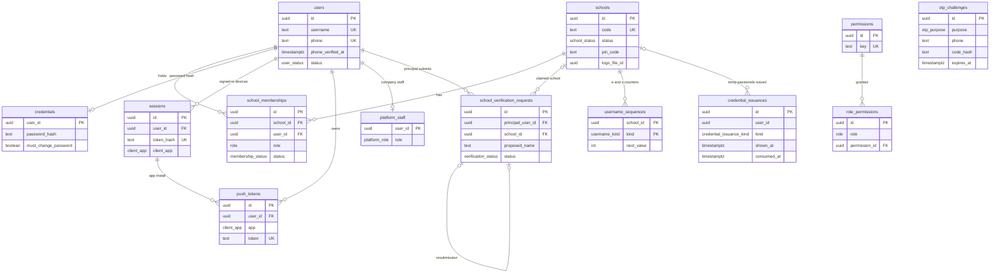
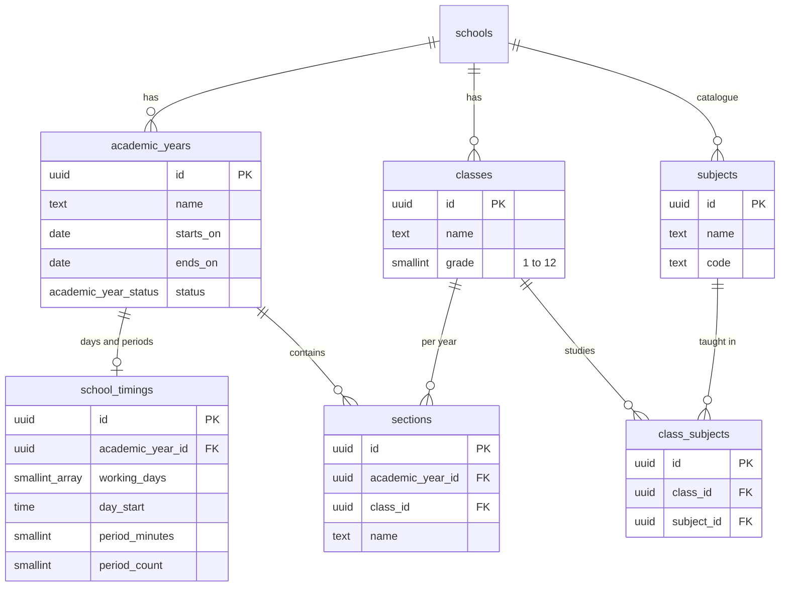
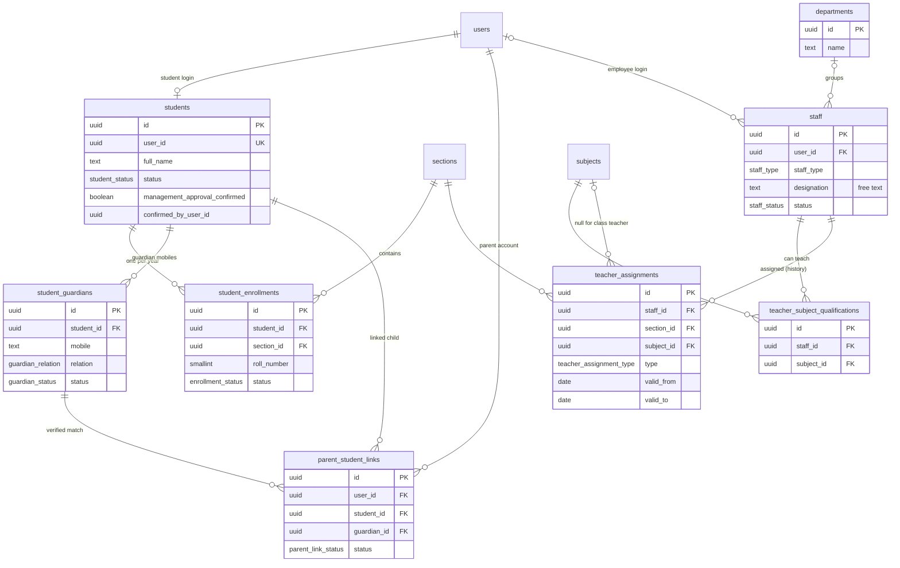
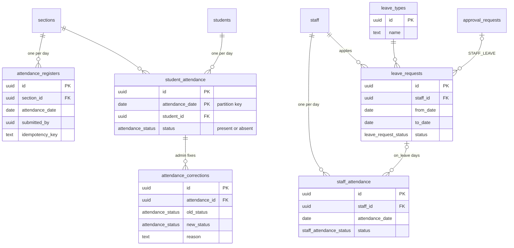
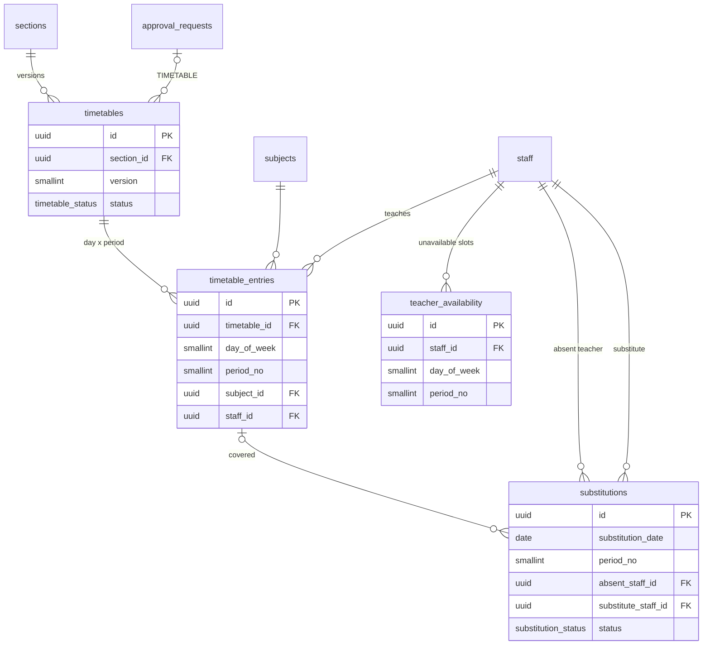
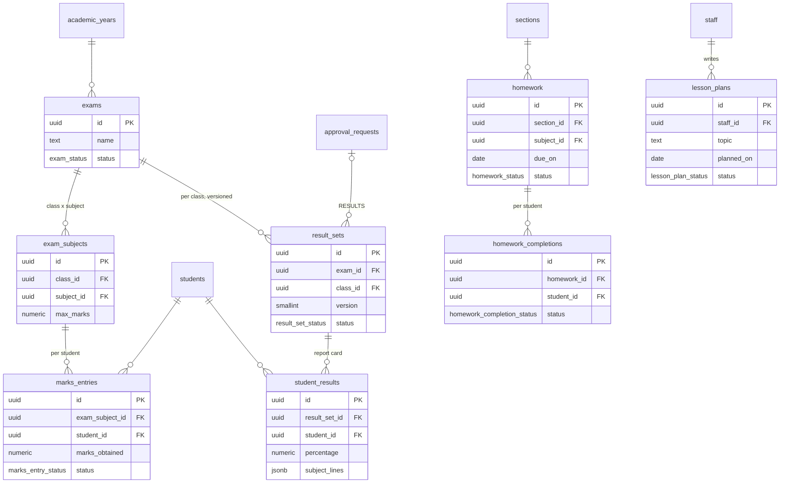
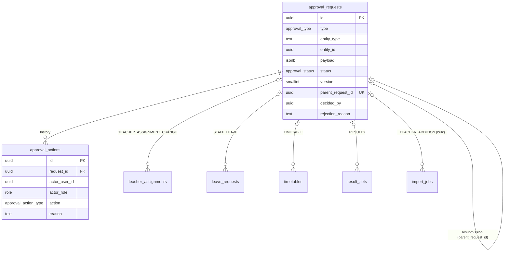
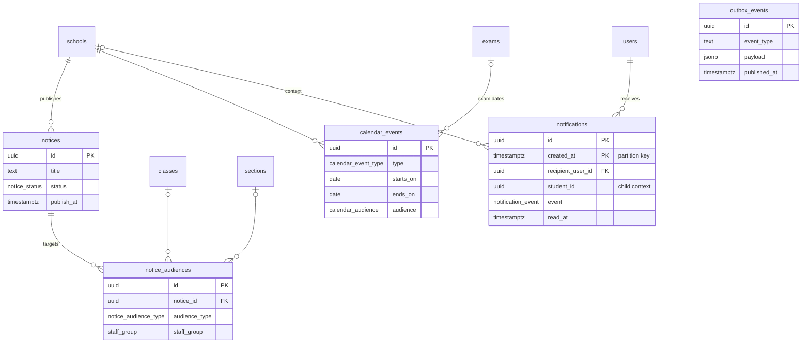
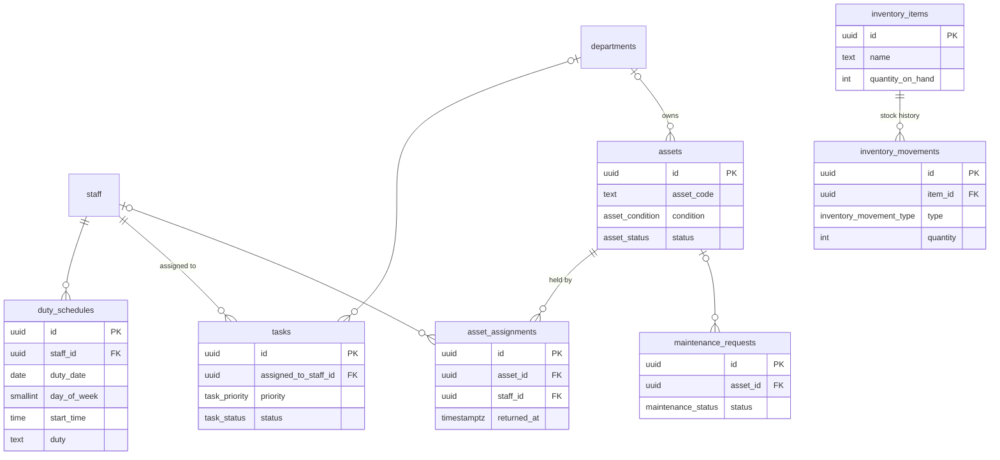
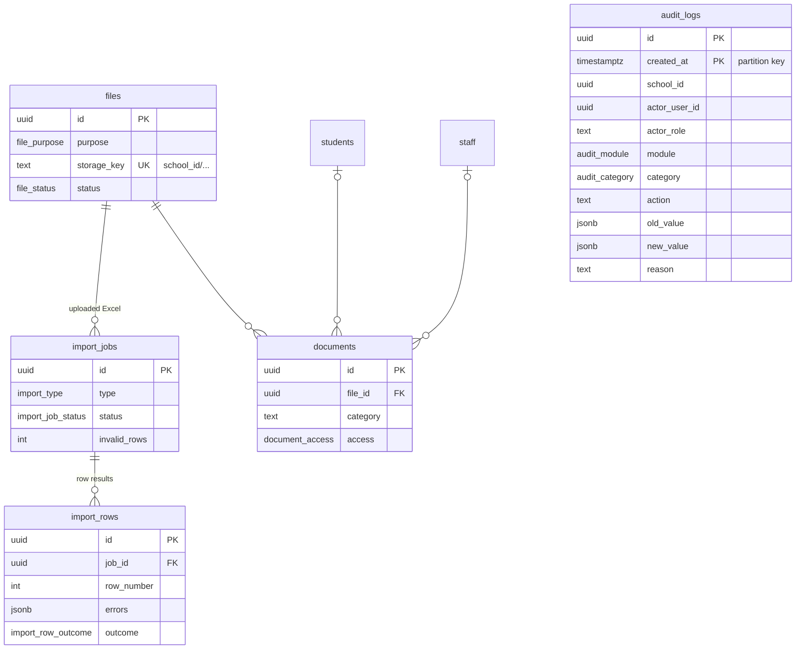

# ER diagrams (draft V1.1)

One diagram per module, key columns only (full columns in [TABLES.md](TABLES.md)). Every school table also has `school_id`; arrows between school tables are composite foreign keys `(school_id, x_id)`, so a row can never point into another school. `schools` is drawn only where it matters.

## 1. Tenancy and identity

## 2. Academic setup

## 3. People

## 4. Attendance and leave

## 5. Timetable and substitution

## 6. Exams, results, homework, lesson plans

## 7. Approvals

Teacher addition/update and academic-year transition point at their record through `entity_type` + `entity_id` (staff, academic_years) instead of a foreign key.

## 8. Notices, calendar, notifications

No conversations, messages, read receipts or notification preferences exist.

## 9. Non-teaching staff

## 10. Import, files, documents, audit

`audit_logs` has no foreign keys on purpose: audit rows must outlive anything they describe.
